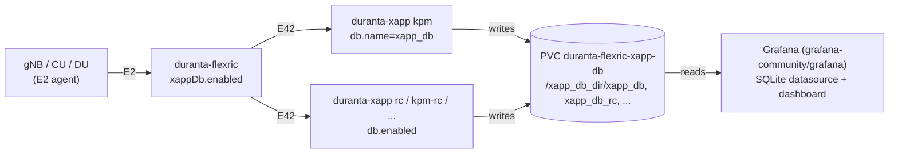

<!-- SPDX-License-Identifier: CC-BY-4.0 -->

# Helm Chart for FlexRIC xApps (`duranta-xapp`)

One chart for the xApps of the FlexRIC CI scenario (`ci-scripts/yaml_files/5g_rfsimulator_flexric` of
openairinterface5g). Each release runs one xApp, selected with `xapp`, so several xApps run side by side
as separate releases. The xApps are part of the FlexRIC image and connect to the near-RT RIC
([`duranta-flexric`](../duranta-flexric/README.md)) over E42 (SCTP 36422).

| `xapp` | Binary in the FlexRIC image | What it does |
|--------|-----------------------------|--------------|
| `kpm` (default) | `xApp/c/monitor/xapp_kpm_moni` | KPM monitoring (subscribes to E2SM-KPM, prints the indications) |
| `rc` | `xApp/c/monitor/xapp_rc_moni` | RC monitoring (subscribes to E2SM-RC) |
| `kpm-rc` | `xApp/c/kpm_rc/xapp_kpm_rc` | KPM monitoring and RC control |
| `gtp-mac-rlc-pdcp` | `xApp/c/monitor/xapp_gtp_mac_rlc_pdcp_moni` | GTP, MAC, RLC and PDCP statistics monitoring |

More binaries of the image can be added under `xapps` in `values.yaml` (name → path), e.g. the slice or TC xApps.

## 🚀 Deployment

The RIC and at least one RAN function with E2 enabled (`config.enableE2: true` in the gNB/CU/DU charts) must be running.

```bash
helm install xapp-kpm ./duranta-xapp --set xapp=kpm
helm install xapp-rc  ./duranta-xapp --set xapp=rc
kubectl logs -f deploy/xapp-kpm-duranta-xapp      # E42 setup, "Connected E2 nodes = N", then the KPM indications
```

An unknown `xapp` fails the install with the list of valid names. xApps can be deployed before or after the UEs:
an xApp running before the UE attaches picks the UE up and starts receiving its data (per-UE KPM measurements,
RRC measurement reports, MAC/RLC/PDCP/GTP statistics) as soon as it is attached. Until then the E2 agent logs
`[E2SM-KPM] No UE matches the condition criteria` and the KPM xApp only receives cell-level measurements.

## 📊 Grafana

As in FlexRIC's `grafana/` directory, the xApps write every indication they receive into an SQLite database, and
Grafana shows it with the SQLite datasource and FlexRIC's "KPI measurements" dashboard (E2SM-KPM, E2SM-RC and
E2SM-CCC panels). On Kubernetes the database lives on one PVC shared by FlexRIC, the xApps and Grafana:



```bash
# 1. RIC with the shared PVC (duranta-flexric-xapp-db, mounted at /xapp_db_dir)
helm install flexric charts/duranta-flexric --set xappDb.enabled=true
# 2. xApps writing into it; the one with db.name=xapp_db is the one Grafana shows
helm install xapp-kpm charts/duranta-xapp --set xapp=kpm --set db.enabled=true --set db.name=xapp_db
helm install xapp-rc  charts/duranta-xapp --set xapp=rc  --set db.enabled=true     # -> /xapp_db_dir/xapp_db_rc
# 3. Grafana (grafana-community chart, successor of the deprecated grafana/grafana) with the FlexRIC datasource and dashboard
helm repo add grafana-community https://grafana-community.github.io/helm-charts
helm install grafana grafana-community/grafana -f charts/duranta-xapp/grafana/values.yaml
# 4. open it
kubectl get secret grafana -o jsonpath='{.data.admin-password}' | base64 -d; echo   # password of user admin
kubectl port-forward svc/grafana 3000:80                                            # http://localhost:3000
```
The dashboard is under **Dashboards → FlexRIC → KPI measurements** and refreshes every second
(`min_refresh_interval: 1s`). With a UE attached and traffic, `DRB.UEThpDl/UEThpUl`, `RRU.PrbTotDl/UL`,
`DRB.PdcpSduVolumeDL/UL`, `DRB.RlcSduDelayDl` and the MCS heatmaps fill up.

[`grafana/values.yaml`](./grafana/values.yaml) does what FlexRIC's `docker-compose` does for Grafana: it installs the
`frser-sqlite-datasource` plugin, sets `min_refresh_interval` to 1s, mounts the PVC at `/xapp_db_dir`, provisions
the `SQLite` datasource (uid `flexric-sqlite`, path `/xapp_db_dir/xapp_db`) and loads the dashboard from
`duranta-project/flexric` (`grafana/dashboards/grafana-dashboard.json`). Without internet access, replace its `url`
by the dashboard JSON (`--set-file dashboards.flexric.kpi-measurements.json=<file>`).

Things to know:
- **One xApp per database file.** FlexRIC aborts when two xApps write the same SQLite file at the same time, so each
  release writes its own file (`xapp_db_<xapp>`) and only one gets `db.name=xapp_db`. Give it to `kpm` for the
  E2SM-KPM panels or to `rc` for the E2SM-RC panels (SINR, RSRP, RSRQ); the CCC panels need a CCC xApp.
- **Same node.** SQLite runs in WAL mode (shared memory next to the file), so the RIC, the xApps and Grafana must run
  on the same node (single-node clusters do this by default; otherwise use `nodeSelector`/`nodeName`).
- **Removing it:** the PVC stays until no pod mounts it, so `helm uninstall flexric --wait` blocks while xApps or
  Grafana still run; uninstall those first (or drop `--wait`).
- The end-to-end tests (`runE2ETests.py --grafana --keep`, maintained separately with the E2E scenarios) deploy all of
  this and leave it running.

## 🔐 OpenShift

With `kubernetesDistribution: Openshift` (or `global.kubernetesDistribution`) the chart creates its own
`SecurityContextConstraints` `<release>-duranta-xapp-<namespace>` and lets the xApp's service account use it
(Role + RoleBinding). The restricted SCC would give the pod a random UID that cannot run as root, while the xApp
runs as root to write `flexric.conf` and its SQLite files; the dedicated SCC allows that and nothing more: no
privileged container, no privilege escalation, all capabilities dropped, RuntimeDefault seccomp and only
configMap/emptyDir/PVC/secret/projected/downwardAPI volumes. The containers request exactly that
(`allowPrivilegeEscalation: false`, `capabilities.drop: [ALL]`). Creating an SCC is cluster-scoped, so the
install needs a user allowed to create `securitycontextconstraints`.

For Grafana on OpenShift add [`grafana/values-openshift.yaml`](./grafana/values-openshift.yaml), which lets the
restricted SCC assign the UID instead of the chart's fixed 472:
```bash
helm install grafana grafana-community/grafana -f charts/duranta-xapp/grafana/values.yaml -f charts/duranta-xapp/grafana/values-openshift.yaml
```

## Parameters

| Parameter | Allowed Values | Description |
|------------|----------------|--------------|
| **xapp** | `kpm` / `rc` / `kpm-rc` / `gtp-mac-rlc-pdcp` | xApp run by this release (default: `kpm`) |
| **xapps** | Map | xApp name → binary path in the image |
| **config.ricHost** | String | near-RT RIC service name or IP (default: `duranta-flexric`); with FlexRIC on multus use the RIC's E2 IP |
| **config.timeZone** | String | Container timezone |
| **kubernetesDistribution** | `Vanilla` / `Openshift` | Select Kubernetes flavor |
| **nfimage.repository / version / pullPolicy** | String | Image with the xApps (default: the FlexRIC image, `develop`) |
| **imagePullSecrets** | List | Optional; for private registries, e.g. `[{name: regcred}]` |
| **serviceAccount.create / annotations** | | Service account of the xApp |
| **db.enabled** | `true` / `false` | Write the received data into the shared PVC of `duranta-flexric` (`xappDb.enabled`) for Grafana |
| **db.claimName** | String | PVC to use (default: `duranta-flexric-xapp-db`) |
| **db.name** | String | SQLite file name in the PVC (default: `xapp_db_<xapp>`; `xapp_db` = the file the Grafana datasource reads) |
| **multus.enabled** | `true` / `false` | Add an interface on the RIC's E2/E42 network (only needed when FlexRIC uses multus) |
| **multus.interfaces[]** | List | `name`, `hostInterface`, `ipAdd`, `netmask`, `type` (`macvlan`/`vlan`), `mode`, `vlan`, `gateway`, `defaultRoute`, `routes`, `mtu`, `mac`, `enabled`; give each release its own `ipAdd` |
| **resources.define** | `true` / `false` | Apply `resources.limits` / `resources.requests` |
| **terminationGracePeriodSeconds** | Integer | Grace period before termination (default: 5 s) |
| **nodeSelector / nodeName** | Map / String | Pod scheduling |

## How it works

- With `db.enabled`, `flexric.conf` also gets `DB_DIR = /xapp_db_dir/` and `DB_NAME`, and the PVC is mounted there.
- An init container resolves `config.ricHost` (the RIC's headless service resolves once the RIC pod is ready) and
  writes `flexric.conf` with `NEAR_RIC_IP` set to it, as in the CI scenario's `conf/flexric.conf`.
- The xApp container runs `stdbuf -o0 <binary>` from the FlexRIC image, like the CI's docker-compose services
  (wrapped in `sh -c "umask 0000; exec ..."` so the SQLite files stay usable for Grafana); its readiness probe is
  `pgrep -f <binary>`, the CI's health check.
- All resources are named after the release (`<release>-duranta-xapp`), so any number of xApps can be installed.
