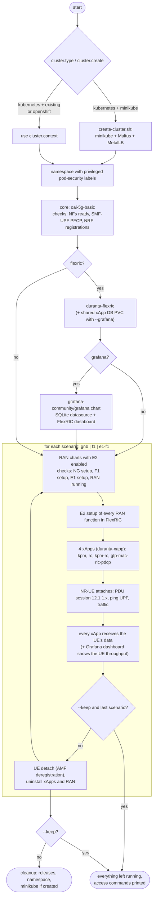
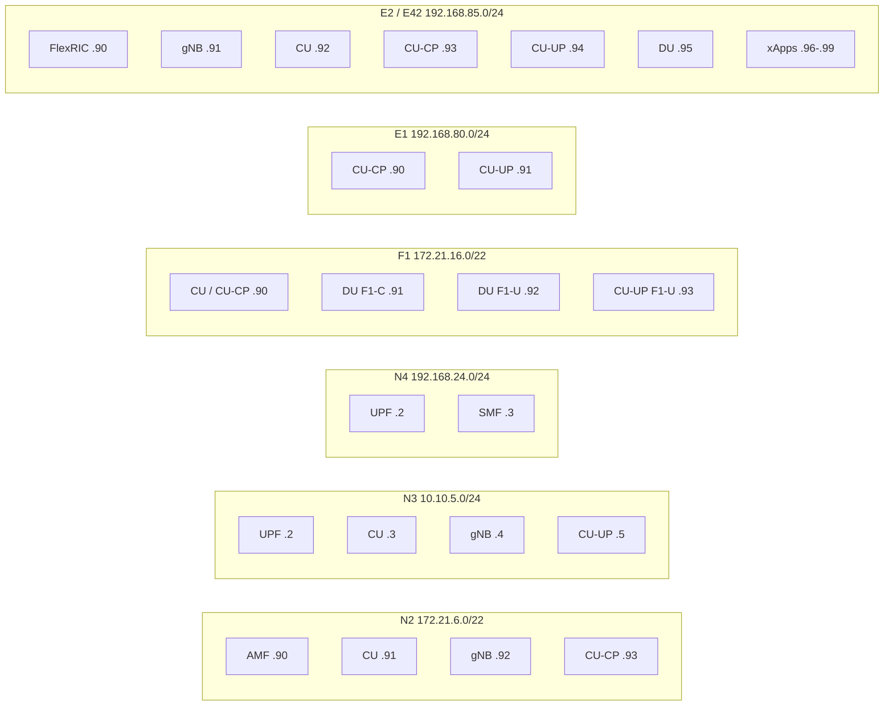

<!-- SPDX-License-Identifier: CC-BY-4.0 -->

# CI scripts

| Script | What it does |
|--------|--------------|
| [`checkHelmChartSyntax.sh`](./checkHelmChartSyntax.sh) | Offline: `helm dependency build` + `helm template` of every chart under `charts/` (no cluster) |
| [`create-cluster.sh`](./create-cluster.sh) | Creates a minikube cluster with Multus and MetalLB; `NODES`, `CONTAINER_RUNTIME`, `CPUS` and `MEMORY` select its size and runtime (e.g. the CNTi Test Suite cluster: `NODES=2 MEMORY=8G CONTAINER_RUNTIME=containerd`) |
| [`publishCharts.sh`](./publishCharts.sh) | Packages every chart and pushes it to an OCI registry |
| [`runE2ETests.py`](./runE2ETests.py) | End-to-end test and deployment tool: OAI 5G core, FlexRIC, xApps, Grafana and the RAN scenarios with an NR-UE, with or without multus, on minikube, an existing Kubernetes cluster or OpenShift; core charts from openairinterface/orchestration, RAN charts from duranta-project/helm-charts |
| [`e2e-config.yaml`](./e2e-config.yaml) | Settings of `runE2ETests.py` |
| [`values/`](./values) | Multus override files used by `runE2ETests.py --multus` |

Every script has `-h` / `--help` or a usage header. The CNTi Test Suite runner is [`lfn-cnti/runCNTI.sh`](../lfn-cnti/README.md).

## runE2ETests.py

### How it works



Every check polls the logs (or the Grafana API) until it passes or `checkTimeout` (180 s) expires; installs wait up to
`timeout` (600 s). On a failure the script prints the pods, the last log lines of the involved pods and the logs of
init containers that are not ready, then cleans up (unless `--keep`). Exit code 0 = every check passed.

| Scenario | RAN charts | Signalling checked |
|----------|------------|--------------------|
| `gnb` | `duranta-oai-gnb` | NG setup, gNB running, E2 setup (1 node) |
| `f1` | `duranta-oai-cu` + `duranta-oai-du` | NG setup, F1 setup, DU running, E2 setup (CU + DU) |
| `e1-f1` | `duranta-oai-cu-cp` + `duranta-oai-cu-up` + `duranta-oai-du` | NG setup, E1 setup, F1 setup, DU running, E2 setup (CU-CP + DU) |

Then in each scenario: the xApps `kpm` (per-UE KPM measurements), `rc` (RRC measurement reports), `kpm-rc` (RC control
acknowledged) and `gtp-mac-rlc-pdcp` (MAC/RLC/PDCP/GTP indications) must receive the UE's data; they are started
before the UE on purpose. In `e1-f1` the CU-UP cannot connect to the RIC (OAI `nr-cuup` bug in `read_setup_ran()`),
so only the CU-CP and DU are E2 nodes: `kpm-rc` is checked on its KPM part (its RC control is handled by the CU-UP)
and `gtp-mac-rlc-pdcp` on the DU's MAC and RLC statistics (PDCP and GTP run in the CU-UP).

### Where the charts come from

The script is the same in openairinterface/orchestration (OAI 5G core charts) and duranta-project/helm-charts (Duranta
RAN, FlexRIC and xApp charts): the charts of this repository are used from the checkout and the other repository is
cloned (`main`), see `charts` in [`e2e-config.yaml`](./e2e-config.yaml). Either set can come from a local folder or
from any git repository and branch:

```bash
./ci-scripts/runE2ETests.py --core-path ../orchestration                     # core charts from a local checkout
./ci-scripts/runE2ETests.py --ran-git https://github.com/<fork>/helm-charts.git --ran-branch my-feature
./ci-scripts/runE2ETests.py --core-branch develop                            # other branch of the default repository
```

### Usage

```bash
./ci-scripts/runE2ETests.py --help

# CI: fresh minikube cluster, cluster network only, everything removed at the end
./ci-scripts/runE2ETests.py
# CI with multus
./ci-scripts/runE2ETests.py --multus
# one scenario, specific images
./ci-scripts/runE2ETests.py --scenarios f1 --ran-tag 2026.w40 --core-tag v2.2.2

# users: deploy everything and keep it (core, FlexRIC, Grafana, F1 split RAN, UE, 4 xApps)
./ci-scripts/runE2ETests.py --scenarios f1 --multus --grafana --keep
```

With `--keep` the last scenario is not torn down and the script prints how to reach the pods, the UE, the xApp logs
and Grafana (`kubectl port-forward svc/grafana 3000:80`, user `admin`, password from the `grafana` secret; dashboard
**FlexRIC / KPI measurements**) and how to remove everything.

Existing cluster or OpenShift, with a settings file:

```yaml
# my-cluster.yaml
cluster:
  type: kubernetes        # or openshift
  create: existing        # ignored for openshift
  context: my-context     # empty = current kubectl context
namespace: oai-e2e
multus: true
valuesDir: my-values      # copy of ci-scripts/values adapted to the cluster (see Multus)
```
```bash
./ci-scripts/runE2ETests.py -c my-cluster.yaml --grafana --keep
```

### Settings ([`e2e-config.yaml`](./e2e-config.yaml))

| Setting | CLI | Default | Meaning |
|---------|-----|---------|---------|
| `cluster.type` | | `kubernetes` | `kubernetes` or `openshift` (installs with `kubernetesDistribution=Openshift`) |
| `cluster.create` | | `minikube` | `minikube` creates a cluster (deleted at the end if `deleteAfter`), `existing` uses `context` |
| `cluster.context` | | current | kubectl/helm context |
| `cluster.deleteAfter` | | `true` | delete the minikube cluster created by the script |
| `charts.core` / `charts.ran` | `--core-path`, `--core-git`, `--core-branch` / `--ran-path`, `--ran-git`, `--ran-branch` | this repository (`path: "."`) and a clone of the other one (`main`) | `path` (local repository) or `git` + `branch` (cloned for the run) of the core and of the RAN/FlexRIC charts |
| `namespace` | | `oai-e2e` | namespace of all releases |
| `multus` | `--multus` / `--no-multus` | `false` | dedicated networks for N2, N3, N4, F1, E1, E2 |
| `valuesDir` | | `ci-scripts/values` | multus override files |
| `flexric` | | `true` | deploy FlexRIC, enable E2 in the RAN charts and run the xApps |
| `grafana` | `--grafana` | `false` | deploy Grafana fed by the xApps and check the dashboard |
| `scenarios` | `--scenarios` | `gnb,f1,e1-f1` | scenarios to run, in this order |
| `images.coreTag` / `ranTag` / `flexricTag` | `--core-tag` / `--ran-tag` / `--flexric-tag` | chart defaults | image tag of all core NFs / RAN charts / FlexRIC and xApps |
| `images.charts.<chart>` | | | per chart `{repository, tag}`, wins over the tags above |
| `timeout` / `checkTimeout` | | `600` / `180` | seconds for an install / for a check |
| | `--keep` | | keep everything and leave the last scenario running |

## Multus

Without multus every network function uses only the pod network (`eth0`) and reaches the others through their
Kubernetes services. With `--multus` each 3GPP / O-RAN interface gets its own macvlan network, as in a real
deployment with separate transport networks, using the override files in [`values/`](./values):



| File | Chart | What it sets |
|------|-------|--------------|
| `oai-5g-basic-multus.yaml` + `oai-5g-basic-config-multus.yaml` | core | AMF N2, SMF N4, UPF N3/N4 interfaces, and the core `config.yaml` binding N2/N3/N4 to them |
| `duranta-oai-gnb-multus.yaml`, `duranta-oai-cu-multus.yaml`, `duranta-oai-cu-cp-multus.yaml`, `duranta-oai-cu-up-multus.yaml`, `duranta-oai-du-multus.yaml` | RAN | interfaces plus `amfHost`, `cuHost`, `cucpHost`, `ricHost` = the peer's multus IP |
| `duranta-flexric-multus.yaml`, `duranta-xapp-multus.yaml` | RIC / xApps | E2/E42 interface; the xApps get consecutive addresses from `.96` |
| `duranta-oai-nr-ue-multus.yaml` | NR-UE | the UE stays on the pod network (RF simulator to service `oai-ran`) |

Points to keep in mind:
- **Peers are addressed by IP.** An NF bound to a multus interface does not listen on `eth0`, so the service name of a
  peer resolves to an address where nothing listens; the override files therefore set `amfHost`, `cuHost`,
  `cucpHost` and `ricHost` to the multus IPs.
- **Unique addresses.** Two pods with the same IP on one network answer each other's ARP, and traffic goes to a random
  one (e.g. the IMS on the AMF's N2 address refused NG setup). The script fails after every install if two pods
  share a multus IP.
- **Host interface.** The files use `hostInterface: eth0` (the minikube node). On another cluster copy the directory,
  change `hostInterface` (and the subnets if they collide with your networks) and pass it with `valuesDir`.

## Making changes

- **Chart changes:** run `./ci-scripts/checkHelmChartSyntax.sh`, then `./ci-scripts/runE2ETests.py` without and
  with `--multus` (and `--grafana` when touching FlexRIC or the xApps). Use `--scenarios` and `--keep` to iterate on
  one scenario and inspect the pods afterwards.
- **Other images:** `--ran-tag`, `--core-tag`, `--flexric-tag` or `images.charts.<chart>` in the settings file.
- **Different networks:** copy `values/`, edit it, point `valuesDir` at it; every chart's `multus.interfaces[]` is
  documented in its README.
- **A new check:** add `self.expect_log(<chart or label selector>, "<log line>", "<description>")` to the scenario
  (see `scenario_f1`); it polls until `checkTimeout`.
- **A new scenario:** add a `scenario_<name>()` method that installs the RAN charts and checks their setup, then
  calls `self.run_scenario(<number of E2 nodes>, [(release, label), ...], since)` for the common E2, xApp and UE part;
  add the name to `SCENARIOS`.
- **A new xApp:** add it to `xapps` in `charts/duranta-xapp/values.yaml` (duranta-project/helm-charts) and to `XAPPS` in the script with the
  log line that proves it receives data.
